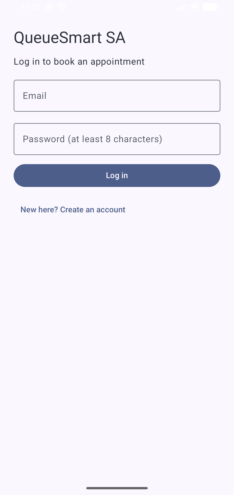
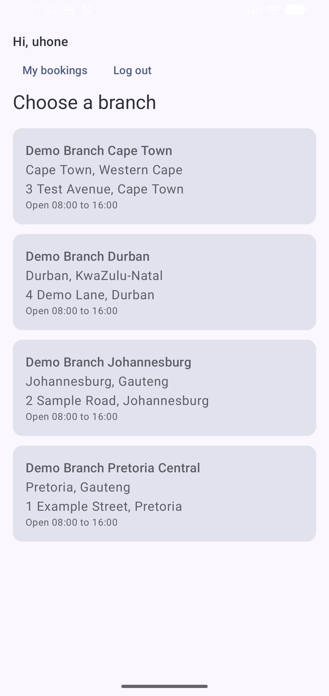
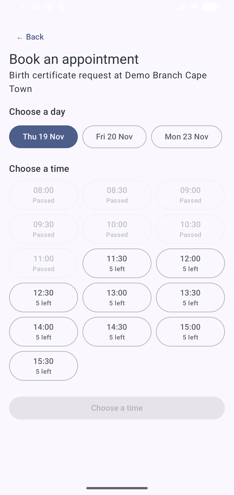
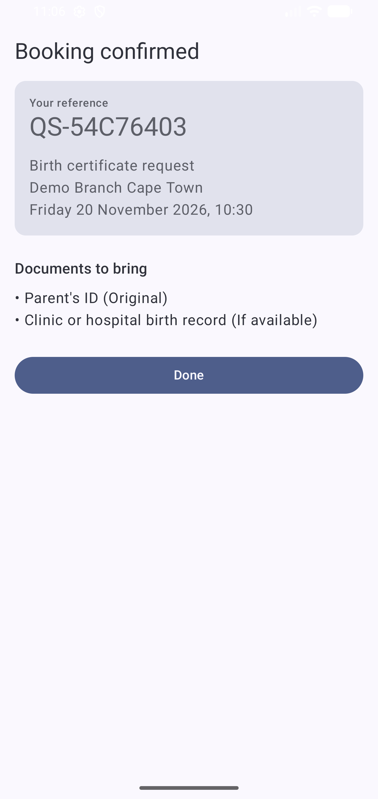
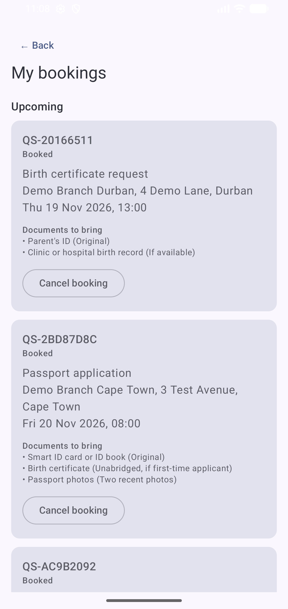

# QueueSmart SA

Appointment booking and queue management for public service offices in South Africa. Android app, REST API and PostgreSQL database, deployed online.

> Demo project. Not affiliated with the Department of Home Affairs or any
> government body. All data is fictional.

## The problem

Long queues at public service offices waste people's time and make it hard for offices to plan their day. QueueSmart SA lets people book a time slot, see which documents to bring, and cancel if their plans change. Branches set a capacity per slot, so a slot can never be overbooked.

## Screenshots

<table>
  <tr>
    <td align="center"><br>Log in or sign up</td>
    <td align="center"><br>Choose a branch</td>
    <td align="center"><br>Documents to bring</td>
  </tr>
  <tr>
    <td align="center"><br>Pick a day and time</td>
    <td align="center"><br>Booking confirmed</td>
    <td align="center"><br>My bookings</td>
  </tr>
</table>

## What works today

- Sign up and log in. Passwords are hashed with bcrypt, and sessions use signed tokens that expire after 7 days.
- Branches with opening hours, and services with a checklist of documents to bring.
- 30-minute time slots with a capacity limit per slot. Weekends are closed, and times use South African time.
- Booking is safe under load. The booking runs in a database transaction that locks the branch while it counts the slot's bookings, so two people cannot take the last place at the same time. One person cannot hold two bookings in the same slot.
- My bookings, with cancellation. Only the owner can cancel, and a cancelled place becomes available again immediately.
- The backend is deployed online and the app works without a local server.

## Not built yet

- Staff dashboard for managing a branch's day
- Staying logged in after the app is closed
- Reminder notifications
- Multiple languages (English, isiZulu, Afrikaans)
- Automated tests and rate limiting on sign-up and login

## How it fits together

```
Android app (Kotlin, Jetpack Compose)
        |  HTTPS + JSON, signed token in the Authorization header
        v
REST API (Next.js route handlers, TypeScript) on Vercel
        |  Prisma
        v
PostgreSQL on Neon
```

## Tech stack

| Part | Technology |
|---|---|
| Mobile app | Kotlin, Jetpack Compose, Retrofit |
| API | Next.js, TypeScript |
| Database | PostgreSQL (Neon), Prisma |
| Auth | bcryptjs, JWT (jose) |
| Hosting | Vercel |

## API

| Method | Path | Needs login | Description |
|---|---|---|---|
| GET | `/api/health` | No | Is the service running |
| GET | `/api/branches` | No | List branches |
| GET | `/api/services` | No | List services with their required documents |
| GET | `/api/slots?branchId=...&date=YYYY-MM-DD` | No | Time slots with remaining places |
| POST | `/api/auth/register` | No | Create an account |
| POST | `/api/auth/login` | No | Log in and receive a token |
| POST | `/api/appointments` | Yes | Book a slot |
| GET | `/api/my-appointments` | Yes | List your bookings |
| DELETE | `/api/appointments/{id}` | Yes | Cancel one of your bookings |

Live API check: https://queuesmart-sa-gvgi.vercel.app/api/health

## Design decisions

- **Preventing overbooking.** The booking endpoint locks the branch row (`SELECT ... FOR UPDATE`) inside a transaction, counts the slot's active bookings, and only then saves.
- **Login errors.** A wrong email and a wrong password return the same message, so nobody can use the login to find out which emails have accounts.
- **Cancelling.** Asking to cancel someone else's booking returns "not found", so the API does not reveal that the booking exists.
- **Time zones.** South Africa has no daylight saving, so a fixed UTC+2 offset is used on the server.
- **Personal data.** The app stores only a name, an email and a password hash. It does not collect ID numbers. This follows the data-minimisation idea in POPIA, but it is not a compliance claim.

## Run it yourself

**Backend**

```bash
cd backend
npm install
```

Create `backend/.env` with:

```
DATABASE_URL="your PostgreSQL connection string"
JWT_SECRET="a long random string"
```

Then:

```bash
npx prisma migrate deploy
npx tsx prisma/seed.ts
npm run dev
```

The seed script clears the branch and service tables before adding the demo data, so only run it on a database you are happy to reset.

**Android app**

Open the `android` folder in Android Studio and run it. The API address is `BASE_URL` in `Api.kt`. To use a local backend, change it to your own address.

## Project structure

- `android/` the mobile app
- `backend/` the API and database schema
- `docs/screenshots/` images used in this README